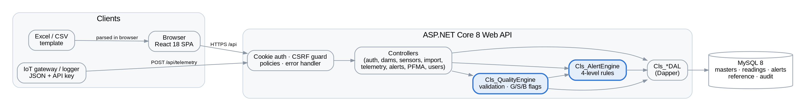

# Architecture

## Layers
| Layer | Location | Responsibility |
|---|---|---|
| React SPA | `frontend/src` | Pages, forms, charts. Calls `/api` with the session cookie. Role checks only hide or lock controls — the server enforces everything. |
| Controllers | `backend/.../Controllers/Controllers.cs` | HTTP endpoints, input checks, authorization policies, audit entries. Thin — no SQL. |
| Engines | `backend/.../Engine/Engines.cs` | `Cls_QualityEngine` (import / telemetry validation, quality flags, commit), `Cls_AlertEngine` (four-level rules), `Cls_Stats` (pure maths). |
| DAL | `backend/.../DAL/DataAccess.cs` | `Cls_*DAL` classes using Dapper. One class per aggregate. All SQL lives here. |
| Common | `backend/.../Common/Common.cs` | Configuration, roles, policy map, password hashing, JSON UTC dates, `BusinessException`. |
| Database | `database/` | MySQL schema and reference seed. |

## Data flow — readings
1. **Excel**: the browser parses the workbook (SheetJS) into JSON rows → `POST /api/import` with `commit=false` (preview) → user reviews → `commit=true`.
   **IoT**: gateway posts JSON to `POST /api/telemetry` with `X-Gateway-Code` + `X-Api-Key`.
2. `Cls_QualityEngine` validates every row (mandatory fields, master match, unit, time, duplicates, logger status, range),
   then applies spike and flatline checks on the merged series, and assigns G / S / B flags.
3. On commit: masters upserted, readings bulk-inserted (500 rows per statement, `INSERT IGNORE` on `(sensor_id, observed_at)`),
   unknown-sensor rows quarantined, import batch and issues stored, audit written.
4. `Cls_AlertEngine.EvaluateDamAsync` runs for each affected dam.

## Alert engine rules (REF-001 §10)
| Rule | Logic | Level |
|---|---|---|
| Threshold | Last *P* (persistence) valid readings beyond alert / alarm / emergency value, direction-aware. Level 3 needs 2 consecutive readings (confirmation). | 1–3 |
| Statistical | Last *P* readings all outside the 14-day mean ± z·σ (response instruments only — not loads or event data). | 1 |
| Rate | 7-day or 3-day least-squares trend beyond the rate limit toward danger; 3-day trend > 2 × 7-day trend = accelerating. | 1 / 2 |
| System | No reading for > 3 expected intervals; calibration overdue. | 1 |
| Corroboration | ≥ 2 sensors linked to the same active PFMA abnormal together. | ≥ 2 |

An open alert for the same sensor and rule is updated (occurrences + 1, highest level kept); an escalation re-opens an
acknowledged alert. Alerts are closed only by a Dam Safety Engineer with a disposition.

## Security
- Session cookie `dm.session` (HttpOnly, SameSite=Lax, Secure over HTTPS, 8 h sliding).
- Passwords: PBKDF2-SHA256, 100 000 iterations. Lockout 15 min after 5 failures. Forced change for new / reset accounts.
- CSRF: every state-changing `/api` call must carry `X-Requested-With: DamMaster` (forces a CORS pre-flight from other origins).
- Authorization: policies in `Common.cs → Policies.Map`; segregation of duties for threshold approval.
- IoT gateways: API key shown once, stored hashed.
- Errors: business errors return 400 with a message; unexpected errors return 500 with a trace id (details only in the server log).

## Key design decisions
| Decision | Reason |
|---|---|
| Dapper + `Cls_` DAL, direct instantiation | Matches the team's existing conventions; SQL is explicit and reviewable. |
| CHAR(36) UUID keys; BIGINT for readings | Team convention for business tables; time series needs compact, ordered keys. |
| No FK constraints, every link indexed | Team convention; integrity enforced in controllers / engines. |
| UTC in the database, IST in the UI | One time standard for calculations; local display for users. |
| SPA served by the API | One IIS site, same-origin cookies, no CORS in production. |

## Phase 2 — operations
| Part | Location | What it does |
|---|---|---|
| `Cls_NotificationEngine` | `Engine/Phase2Engines.cs` | On every new or escalated alert: sets the acknowledgement deadline (`ref_alert_level.ack_minutes`), notifies users of the roles in `ref_alert_level.notify_roles` (in-app + e-mail; SMS from Level 2) and, from Level 2, the dam's EAP contacts of escalation order 1 whose threshold level is reached. |
| Escalation | same | An **Open** alert past its deadline moves one step: the next EAP order is notified (step *n* → order *n + 1*), and at step 1 also Approver, Management and Admin users. A new deadline is set; up to `MaxEscalationSteps`. Acknowledging stops escalation; a level increase re-opens and restarts it. |
| `Cls_NotificationDispatcher` | same | Sends queued e-mail (SMTP) and SMS (HTTP gateway template). Not configured → **Simulated**. Three attempts, then **Failed**. |
| `AlertEscalationService` | same | Hosted background job running escalation + dispatch every `EscalationIntervalSeconds`. Admins can also run a cycle on demand. |
| `Cls_InspectionEngine` | same | Level 2+ instrument alerts (threshold, statistical, rate, corroboration) get a special inspection task (one open special inspection per dam, linked to the alert). High findings raise a Level 2 alert, Critical findings a Level 3 alert. Due dates: Critical 1 d, High 7 d, Medium 30 d, Low 90 d. |
| Reading schedule | `ScheduleController` | Required interval per parameter group and life phase (`ref_reading_frequency`) vs. logger interval and actual readings; status On time / Due / Overdue; 30-day compliance %. |
| Monsoon compliance | `InspectionsController.Compliance` | Pre- and post-monsoon inspections per dam and year: Done on time / Done late / Due / Overdue, with open and overdue findings. |

### Inspection workflow
Planned → In progress (checklist: OK / Attention (remark required) / Not applicable; findings) → Completed (every checklist
item recorded; overall condition Good / Fair / Poor / Unsatisfactory) or Cancelled. Findings: Open → Assigned → In progress →
Closed (Dam Safety Engineer only, with a note). The checklist is chosen by the dam's material group (general items +
concrete, embankment or masonry items) from `ref_inspection_item`.

## Phase 3 — analytics
| Part | Location | What it does |
|---|---|---|
| `Cls_Hst` | `Engine/Phase3Engines.cs` | Pure maths: design-matrix rows, least squares (normal equations, Gaussian elimination, tiny ridge), split of a prediction into water-level, seasonal and time parts. |
| `Cls_HstService` | same | Fits a model to a response sensor's valid readings paired with reservoir level (nearest within ±12 h). ≥ 330 days → full HST (11 terms); 30–330 days → provisional H+T (a0, z, z², τ). Stores R², residual σ, drift per year. Models are Draft until approved by someone other than the fitter (Dam Safety Engineer / Approver; R² ≥ 0.5). |
| HST alert rule | `Cls_AlertEngine` | With an Active model, the last *P* readings all outside prediction ± k·σ raise a Level 1 `HST` alert; the 14-day statistical rule is then not used for that sensor. |
| `Cls_ResponseAnalysis` | same | Lagged correlation with reservoir level (0–168 h), slope per metre, scatter; correlation of reading changes with rain in the previous 24 h (lags 0–72 h); rain days above a threshold with the rise in the next 72 h; plain-English interpretation. |
| `Cls_DhiEngine` | same | Six weighted components (weights in `ref_dhi_component`), each with reasons; risk = min(100, (100 − DHI) × 1.6 × hazard factor + 4 × open Level 2+ instrument / corroboration alerts + 6 × monsoon inspection overdue). Snapshots daily (background job) and on demand. |
| `Cls_AvailabilityReport` | same | Expected vs received / valid readings, longest gap, per sensor, over a window ending at the latest reading or now. |

Reservoir level for HST and response analysis comes from the dam's first active `RWL` sensor.

## Phase 4 — live IoT and scale
| Part | Location | What it does |
|---|---|---|
| `MqttIngestionService` | `Engine/Phase4Engines.cs` | MQTTnet client; subscribes `{root}/+/+/telemetry` and `/status` at QoS 1 with a persistent session; reconnects with back-off (5 → 60 s); publishes an `ack` per message. Status counters exposed on `/api/system/status`. |
| `Cls_TelemetryProcessor` | same | One path for MQTT and HTTP: `messageId` registered in `gateway_message` (unique per gateway → redelivery is a no-op), dam check, quality engine, late-reading count, latency, gateway timestamps; resolves an open gateway-offline alert. |
| `Cls_GatewayHealthJob` | same | Online ≤ 1.5 intervals, Late ≤ 3, Offline > 3 → Level 1 `Gateway` alert; battery below threshold → `GatewayBattery`. Both resolve themselves on recovery. Sensor "no data" (`System`) alerts also resolve when data resumes. **Safety alerts are never closed automatically.** |
| `Cls_HstRefitJob` | same | Daily check: active models older than `Hst:RefitDays` with ≥ 30 days of new data get a new Draft fit (old model stays Active); in-app note to Dam Safety Engineers with R² / σ change and the active model's 30-day bias. |
| `Cls_JobRunner` | same | Runs all jobs every minute (escalation, dispatch, gateway health) and daily (DHI snapshot, HST refit); results in `job_run`; Admin can run all now. |
| `reading_daily` | DAL | Daily count / valid count / min / max / mean per sensor, refreshed for affected days on every import. Charts switch to daily means automatically above 5 000 points. |
| Partitioning (optional) | `006_partition_readings_OPTIONAL.sql` | Yearly RANGE partitions on `observed_at`; PK becomes (id, observed_at); `CALL dm_add_reading_partition(YYYY)` each December. All test suites pass on the partitioned table. |

Measured on the test machine (single API, local MySQL): one Excel/API import of 100 000 readings (10 sensors) in 8–9 s
(≈ 11 000–12 500 readings/s, validation included; partitioned and unpartitioned table); re-importing the same file
(all duplicates) 6–10 s; a two-year chart served from daily aggregates in under 10 ms.

## Phase 5 — design workspace
| Part | Location | What it does |
|---|---|---|
| `DesignMath` | `Engine/DesignEngine.cs` | Pure engineering functions: Molitor wave, seismic coefficient, gravity limit equilibrium, infinite-slope FS, gravity / embankment sizing, type scoring, ogee spillway, modified-Puls routing. |
| `DesignCalcs` | same | The nine calculations in dependency order, each producing a 12-step `CalcRecord` (inputs, assumptions, codes, method, formula, steps, results, checks, interpretation, data). `Dep` lists input keys and upstream calculations (`@code`); `Dependents()` gives everything affected by a change; `Inconsistency()` holds the input rules (MWL ≥ FRL, crest below FRL, …). |
| `Cls_DesignService` | `Engine/DesignService.cs` | Input changes: type / option / consistency checks → save → mark dependents STALE (with reason and dependency path) → change log. Runs: all nine are computed (deterministic, milliseconds); a new version is stored only for calculations that are new, STALE, or whose result changed — a STALE calculation whose result is unchanged is just cleared. Every version is kept in `design_calc_history`. |
| Check / approve | same | Draft → Checked (Checker or Dam Safety Engineer, not the person who ran it) → Approved (Approver, not the runner or checker). STALE calculations cannot be checked or approved; re-running resets approval. Approval is refused until every standard the calculation cites is verified (edition recorded) in `ref_standard`. IFC is not available in the software. |
| `Cls_DesignValidation` | same | 26 reference cases (wave, seismic, gravity sliding / overturning / base pressures, slope, ogee, jump, gate, hoist, hydropower, water hammer, penstock, routing, cost) — same values as the prototype handbook; `GET /api/design/validation`. |
| Tables | `007_phase5_design.sql` | `ref_design_input` (52 inputs with help text), `design_project`, `design_calc` (current version), `design_calc_history`, `design_input_change`, `ref_design_setting` (default elevation–area table). |

## Phase 6 — digital twin, remote sensing, documents, design link
| Part | Location | What it does |
|---|---|---|
| Map | `MapController` + `pages/MapPage.tsx` (Leaflet) | Dams coloured by highest open alert level, sensors with coordinates, latest InSAR dataset per dam (colour by velocity vs threshold). Tile server configurable. |
| Live section | `Cls_TwinService` | Section from the dam's latest linked design project (approved first), else an outline from the dam register; sensors placed by elevation and offset from the heel; latest reservoir and tailwater levels; open alert level per sensor. |
| Surveys | `Cls_SurveyService` | InSAR datasets (velocity, mm/year) — points beyond the threshold raise one Level 1 `InSAR` alert, split into points within `Map:StructureRadiusM` of the dam and points on the rim. Survey campaigns (elevations) compared by point id: change in mm and rate per year. |
| Documents | `Cls_DocIndexer` | Files stored under `Storage:Root` (SHA-256 recorded); text extracted from PDF (PdfPig), Word (.docx, in-box XML), HTML and text; split into ~900-character passages in `doc_chunk` with a MySQL FULLTEXT index; scanned PDFs are stored but flagged as not searchable (OCR needed). |
| Ask | `Cls_LibraryAi` | Top six passages → OpenAI-compatible chat endpoint with a system prompt that allows answers only from the passages and requires citations; if the endpoint is missing or down, the passages are returned with a note. |
| Design → thresholds | `Cls_DesignLink` | Needs the project's Main dam stability calculation Approved and not STALE. Uplift piezometers (kPa, offset set): alarm = γw·u·(FRL − foundation)·(1 − x/B), alert = 80 %, emergency = drains-inoperative (u = 1). Reservoir level: alert FRL, alarm MWL − 0.5 m, emergency MWL. Applied as new threshold versions (method Design, basis citing project and calculation version) that still need approval. |

## Phase 7 — field, OCR, SSO, federation
| Part | Location | What it does |
|---|---|---|
| Inspection rules | `Cls_InspectionService` (`Engine/Phase7Field.cs`) | One implementation of start / checks / findings / complete used by the web pages and by field sync, so offline work is validated exactly like desk work. |
| Field sync | `Cls_FieldService` | `POST /api/field/sync` replays a device's queue in order. Each operation's client id is claimed atomically in `field_op` (INSERT IGNORE) before it is applied; repeats and simultaneous requests wait for and return the first result, so lost responses, retries and two devices never duplicate findings. Rejections carry the same messages as the web pages. |
| Field app | `pages/Field.tsx`, `lib/offline.ts`, `public/sw.js` | Installable web app. IndexedDB holds downloaded packages, queued operations and photos; one sync runs at a time and starts automatically when the connection returns. Photos are reduced on the phone to 1 600 px JPEG (≈ 0.3 MB) and carry GPS and time. The service worker caches the app shell; API calls are never cached. If the network (not the server) fails, the last signed-in user is kept so the app works offline — the server still authorises every sync. |
| Photos | `Cls_FieldService.AddPhotoAsync` | JPEG / PNG checked by file signature, size read from the header, ≤ 10 MB, stored under `Storage:Root/photos`; can reference the finding by its offline client id; `clientRef` makes uploads idempotent. |
| OCR | `Cls_Ocr` | When a PDF or image yields no text: `pdftoppm` renders pages (200 dpi) and `tesseract` reads them; time-limited external processes; the file is flagged "read by OCR". |
| SSO | `Cls_Oidc`, `SsoController` | Authorization-code flow with PKCE (S256); state, nonce and verifier in a data-protected, 10-minute cookie; token exchange; id_token RS256 signature verified against the provider's JWKS (re-read once on failure for key rotation); issuer, audience, expiry, not-before and nonce checked; user matched to an existing account, subject id bound on first use; no auto-provisioning. |
| Federation | `Cls_Federation`, `FederationController` | `GET /api/federation/summary` (constant-time key check) returns only portfolio summaries; the hub calls all configured instances in parallel (10 s timeout) and reports unreachable or unauthorised ones explicitly. |
| 3-D view | `components/Twin3D.tsx` (three.js, lazy-loaded) | The design section extruded along the crest length, reservoir at its latest level, instruments at offset / elevation / chainage, coloured by alert level. |
